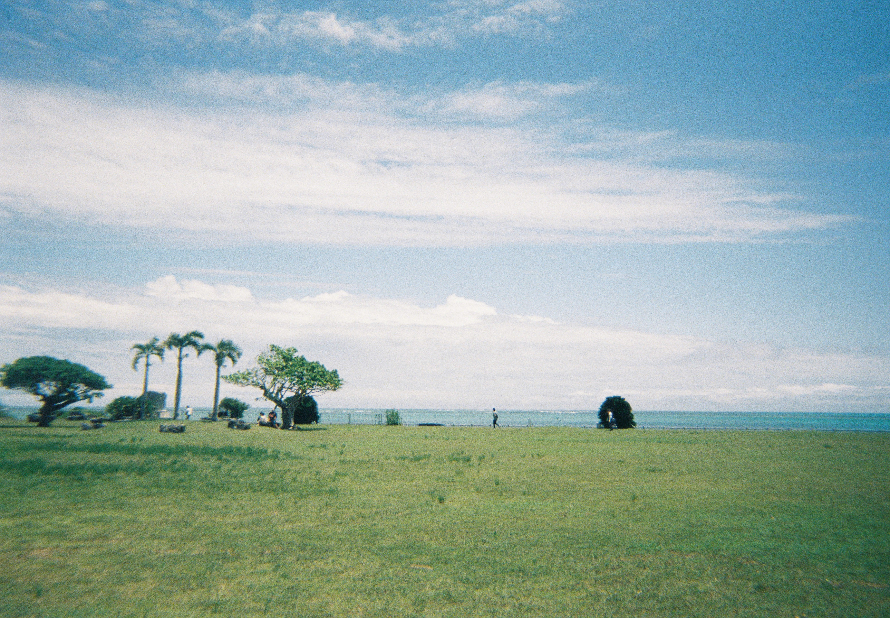

Last updated: July 2026

Still living in Tokyo and working at Braid, headquartered in the Shibuya area.

Helping out with Summer Geometry Initiative 2026.

Will attend the WCA-sanctioned Japan Championships 2026 held in Osaka, practicing a bit of 2x2-7x7 and Square-1. It's the first national championship (全国大会) since 2019.

Sunny day in Ishigaki-jima, Okinawa during Golden Week 2026.
